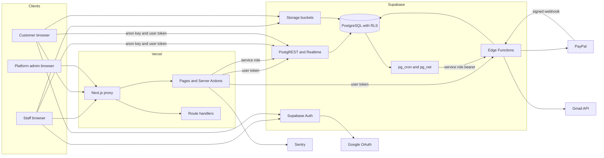
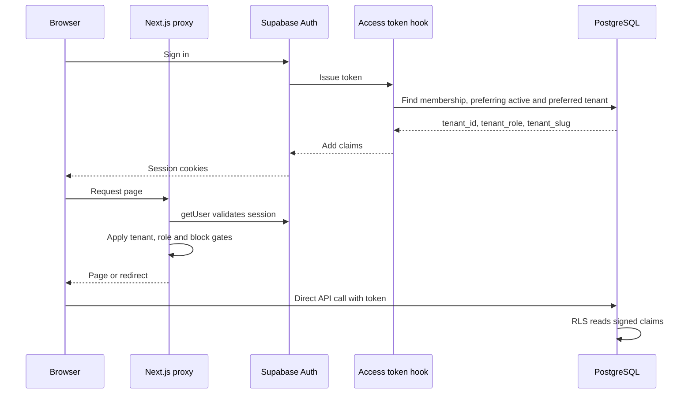
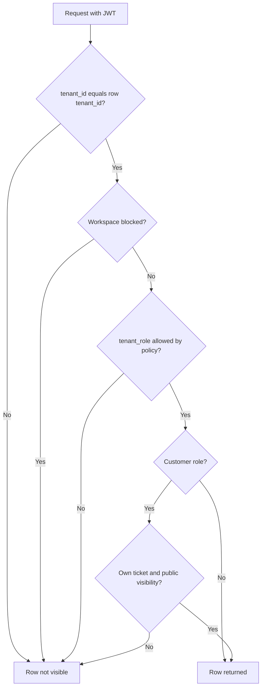
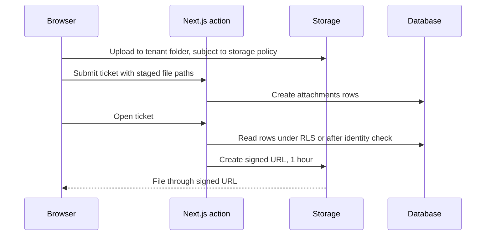
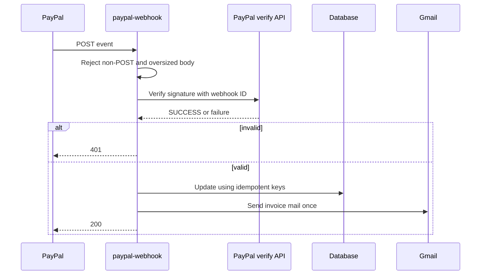

# ServiceDesk SaaS: Security Architecture

| Field           | Value                                                     |
| --------------- | --------------------------------------------------------- |
| Assessment date | 2026-11-04                                                |
| Document status | Draft for review                                          |
| Code baseline   | Branch `develop`, commit `ec4b56a`                        |
| Evidence basis  | Repository code. **Live configuration was not available** |

Related documents: [Assessment](application-security-assessment.md) · [Remediation tracker](security-remediation-tracker.md)

This document describes what the code implements. Items marked **Unverified** could not be confirmed from the repository. Gaps link to their finding rather than repeating it.

## 1. System overview

**The key point:** browsers can reach PostgREST and Storage directly with the public anon key. The Next.js proxy and Server Actions do not sit in front of that path, so **RLS and storage policies are the real boundary**.

## 2. Authentication architecture

| Element            | Implementation                                                                                                               | Location                                                          |
| ------------------ | ---------------------------------------------------------------------------------------------------------------------------- | ----------------------------------------------------------------- |
| Staff sign-in      | Password and Google OAuth through Supabase Auth                                                                              | `src/features/auth/services/auth.service.ts`                      |
| Customer sign-in   | Magic link and password, with its own callback that links the portal membership                                              | `[tenantSlug]/portal/auth/callback/route.ts`, `portal.service.ts` |
| Session storage    | `@supabase/ssr` cookies, SameSite=Lax, Secure on HTTPS, not HttpOnly ([SEC-011](application-security-assessment.md#sec-011)) | `src/lib/supabase/remember.ts`                                    |
| Session lifetime   | Remembered 30 days; otherwise a browser-session cookie                                                                       | `remember.ts`                                                     |
| Token lifetime     | `jwt_expiry = 3600` locally, rotation on. **Live value unverified**                                                          | `supabase/config.toml`                                            |
| Session validation | Proxy calls `getUser()` on each request, then `getClaims()` for tenant data                                                  | `src/proxy.ts`                                                    |
| Link safety        | Trusted-host origin for emails, `safeNext` for return paths, fixed error codes                                               | `auth.service.ts`, `tenancy.ts`                                   |
| Rate limits        | Login, reset, signup, checks and portal actions ([SEC-010](application-security-assessment.md#sec-010))                      | `src/lib/rate-limit.ts`                                           |
| MFA                | **Not implemented** ([SEC-015](application-security-assessment.md#sec-015))                                                  | Search of `src/`                                                  |
| Password policy    | Minimum 8 with no complexity locally. **Live value unverified**                                                              | `supabase/config.toml`                                            |

## 3. Authorization and role model

| Role            | Scope       | Purpose                        | Source                                                            |
| --------------- | ----------- | ------------------------------ | ----------------------------------------------------------------- |
| Platform admin  | All tenants | Operates the console           | `PLATFORM_ADMIN_EMAILS` plus confirmed email, not a database role |
| `tenant_admin`  | One tenant  | Full workspace control         | `memberships.role`                                                |
| `manager`       | One tenant  | Team and operations management | `memberships.role`                                                |
| `agent`         | One tenant  | Works tickets                  | `memberships.role`                                                |
| `billing_admin` | One tenant  | Billing                        | `memberships.role`                                                |
| `customer`      | One tenant  | Portal, own requests only      | `memberships.role`, `customers.portal_user_id`                    |

The workspace owner is `memberships.is_primary`, protected by the `protect_primary_membership` trigger and changed only by `transfer_tenant_ownership`.

Authorization is layered:

| Layer                  | Applies to                | Notes                                                                                                                                          |
| ---------------------- | ------------------------- | ---------------------------------------------------------------------------------------------------------------------------------------------- |
| Proxy                  | Page and action requests  | Tenant match, `isTenantRouteAllowed`, customer and staff separation                                                                            |
| Layout and page guards | Platform console, role UI | `requirePlatformAdmin` in layout and every page                                                                                                |
| Service functions      | Server Actions            | For example `requireActor`, `assertRole`, `canManageTenantBilling`, `assertCanManageSla`                                                       |
| RLS                    | All user-token queries    | Reads role from JWT claim. See [SEC-002](application-security-assessment.md#sec-002) and [SEC-005](application-security-assessment.md#sec-005) |
| Edge Function checks   | Billing                   | Validates the user, then requires `tenant_admin` or `billing_admin`                                                                            |

## 4. Multi-tenant isolation model

- Tenant identity comes from the **signed JWT claim** `tenant_id`, read by `public.current_tenant_id()`. It is not taken from the URL.
- The URL slug is checked against the session slug. A mismatch redirects to the user's own workspace.
- `x-tenant-slug` is stripped from incoming requests and set only by the proxy.
- A person can hold several memberships. The token carries **one** tenant at a time, chosen by the hook. Selection uses `app_metadata.preferred_tenant_id`, which users cannot edit.
- Blocked workspaces are enforced in the proxy and by a restrictive RLS policy. Edge Functions were recorded as unchecked in the 2026-11-03 review.

**Known gaps in this model:** [SEC-003](application-security-assessment.md#sec-003) and [SEC-004](application-security-assessment.md#sec-004). **Unverified:** no test evidence supports this model on the live system. See the [tenant isolation plan](tenant-isolation-tests.md).

## 5. Supabase and PostgreSQL architecture

| Item             | Detail                                                                                                                                                              |
| ---------------- | ------------------------------------------------------------------------------------------------------------------------------------------------------------------- |
| Source of truth  | `supabase/migrations/` (89 files) applied in order, with `supabase/schemas/` as readable mirrors. Drift between them is possible                                    |
| Applied state    | All 89 versions recorded on live, per owner-run SQL on 2026-11-04 ([results](security-remediation-tracker.md#live-check-2026-11-04)). The connector is still denied |
| Clients          | Anon with user token in the browser and server. Service role only in `server-only` modules and Edge Functions                                                       |
| Views            | `customer_csat`, `customer_list` use `security_invoker = true`                                                                                                      |
| SECURITY DEFINER | 71 functions found, each setting `search_path`. Many are trigger functions                                                                                          |
| Public RPC       | `get_tenant_by_slug` is callable by anon and returns the tenant ID, name, slug and branding                                                                         |

## 6. RLS policy strategy

| Pattern               | Tables                                                                    | Rule                                                                                                             |
| --------------------- | ------------------------------------------------------------------------- | ---------------------------------------------------------------------------------------------------------------- |
| Tenant staff          | `tickets`, `customers`, `tags`, `sla_*`, `business_hours`                 | Tenant match and staff role                                                                                      |
| Customer self         | `tickets`, `ticket_messages`, `attachments`, `csat_ratings`               | Own customer record; public messages only                                                                        |
| Admin-only write      | `memberships`, `tenants`                                                  | See [SEC-002](application-security-assessment.md#sec-002), [SEC-007](application-security-assessment.md#sec-007) |
| Read-only for clients | `subscriptions`, `invoices`, `subscription_switches`, `sla_events`        | Writes by service role after migration `20261103160000`                                                          |
| Service role only     | `email_jobs`, `sla_alert_jobs`, `rate_limit_buckets`, `platform_settings` | RLS on with no policies, so clients get nothing                                                                  |
| Reference             | `plans`, `timezones`                                                      | Read access                                                                                                      |
| Restrictive overlay   | Tables with `tenant_id`, `storage.objects`                                | `workspace_not_blocked`                                                                                          |

Policies mostly trust the JWT role, not current membership. `is_active_membership()` is applied only on some tables, as covered in [SEC-005](application-security-assessment.md#sec-005).

## 7. API and server-side authorization boundaries

| Surface                                 | Authentication                         | Authorization                          | Notes                                                 |
| --------------------------------------- | -------------------------------------- | -------------------------------------- | ----------------------------------------------------- |
| Server Actions (16 modules)             | Session cookie                         | Service-level checks                   | Admin-client services were spot-checked only          |
| `/auth/callback`                        | Auth code                              | Tenant match; rejects other workspaces | Fixed error codes                                     |
| `/[slug]/portal/auth/callback`          | `token_hash` or code                   | Links the customer membership          | Refused links close the session                       |
| `/api/workspace-status`                 | None, by design                        | Valid slug only                        | Returns block and maintenance state                   |
| `/api/sentry-test`                      | None in development                    | Platform admin in production           | Throws on purpose                                     |
| `subscription`, `update-payment-method` | Bearer user token                      | `tenant_admin` or `billing_admin`      | No CORS headers in function code                      |
| `paypal-webhook`                        | PayPal signature, `verify_jwt = false` | Signature                              | 413 on oversized body                                 |
| `email-jobs`, `portal-storage-sweep`    | Gateway JWT                            | Payload `role = service_role`          | [SEC-009](application-security-assessment.md#sec-009) |
| `reconcile-subscriptions`               | Gateway JWT                            | **None in code**                       | [SEC-006](application-security-assessment.md#sec-006) |
| Supabase REST, Storage, Auth            | Anon key and user token                | RLS and policies                       | Reachable directly from any client                    |

**CSRF position:** session cookies are SameSite=Lax, Server Actions rely on Next.js origin checks (no custom `allowedOrigins`), route handlers are read-only GETs or auth callbacks, and Edge Functions use bearer tokens. Not tested.

**CORS position:** no custom CORS in `next.config.ts` or Edge Functions. Vercel adds `Access-Control-Allow-Origin: *` to some public responses ([SEC-021](owasp-zap-findings.md#sec-021)). Supabase API CORS is **unverified**.

## 8. File upload and attachment access

| Bucket               | Public | Limit | Type restriction                        | Write access                                                                        |
| -------------------- | ------ | ----- | --------------------------------------- | ----------------------------------------------------------------------------------- |
| `ticket-attachments` | No     | 20 MB | None at bucket level. App assigns types | Staff and owning customer, tenant folder                                            |
| `invoices`           | No     | 10 MB | Not set                                 | [SEC-008](application-security-assessment.md#sec-008)                               |
| `avatars`            | Yes    | 5 MB  | Four image types                        | [SEC-004](application-security-assessment.md#sec-004)                               |
| `branding`           | Yes    | 2 MB  | PNG, JPEG, WebP                         | No client storage policy found in migrations, so writes go through the service role |

The `portal-storage-sweep` function removes staged uploads never filed against a ticket. **Unverified:** whether the server re-checks a direct upload's type after it lands, as uploads go straight from browser to storage.

## 9. Payment and webhook processing

| Control                | Detail                                                                                                                                                                              |
| ---------------------- | ----------------------------------------------------------------------------------------------------------------------------------------------------------------------------------- |
| Signature              | Verified by PayPal's API, using `PAYPAL_WEBHOOK_ID`                                                                                                                                 |
| Idempotency            | Unique `paypal_txn_id`, partial unique `paypal_event_id`, `email_sent_at`, 23505 handling                                                                                           |
| Retry                  | Errors return 500 so PayPal can retry                                                                                                                                               |
| Reconciliation         | `reconcile-subscriptions`. The repository schedules it hourly, but live runs an unmanaged job every minute                                                                          |
| Payment failure        | Grace period, then auto-block through database triggers                                                                                                                             |
| Card data              | No full card numbers or CVV columns in the schema. `payment_methods` stores PayPal tokens and card metadata such as brand, last 4, expiry, BIN and issuer. PCI scope **unverified** |
| Sandbox and production | Set by environment only ([SEC-012](application-security-assessment.md#sec-012))                                                                                                     |

## 10. Email and notification flows

| Flow                                                  | Path                                                           |
| ----------------------------------------------------- | -------------------------------------------------------------- |
| Team and customer invitations, resets, portal sign-in | Queued in `email_jobs`, sent by `email-jobs` through Gmail API |
| Staff and customer ticket emails                      | Database triggers queue jobs                                   |
| SLA alerts                                            | `sla_alert_jobs`, processed from cron                          |
| Invoices                                              | Webhook sends directly, with a signed link valid 7 days        |
| In-app                                                | `notifications` with Realtime, filtered by preferences         |
| Mail sent by Supabase Auth itself                     | **Unverified.** Live SMTP and templates are dashboard settings |

Templates escape dynamic values. Queue payloads can carry auth link data, and `email_jobs` is closed to clients by RLS.

## 11. Background jobs and SLA processing

| Job                                     | Trigger                      | Authentication             |
| --------------------------------------- | ---------------------------- | -------------------------- |
| `sla_tick`, breach and alert processing | pg_cron, inside the database | Runs in database, no token |
| `email-jobs`                            | pg_cron with pg_net          | Service role bearer        |
| `reconcile-subscriptions`               | pg_cron with pg_net          | Service role bearer        |
| `portal-storage-sweep`                  | pg_cron daily                | Service role bearer        |

These run across all tenants and bypass RLS, so correctness relies on their tenant joins. Test [TEN-30](tenant-isolation-tests.md#background-jobs) covers this.

**Live schedules, 2026-11-04:** `email-jobs-every-minute`, `sla-tick-every-15-minutes`, `portal-staging-upload-sweep` (daily, 04:17) and `reconcile-subscriptions-cron` (every minute, not in the repository). **Unverified:** job commands, and where the service role key used by cron is stored. Migration comments contain placeholder setup instructions, and the actual jobs are not visible in the repository.

## 12. Logging, monitoring and error reporting

| System      | What it records                                                                                     | Notes                                                                               |
| ----------- | --------------------------------------------------------------------------------------------------- | ----------------------------------------------------------------------------------- |
| Audit log   | Trigger-written changes with actor, IP and user agent. Actor header trusted for service role only   | Business plan page, plus platform view                                              |
| Sentry      | Errors and 10% traces. `dataCollection` turns off users, cookies, headers, bodies and query strings | Live alert rules **unverified**                                                     |
| Vercel logs | Request logs including URLs                                                                         | This matters for [SEC-014](owasp-zap-findings.md#sec-014). Retention **unverified** |
| Console     | Supabase logs and DB health through the Management API token (Logs read, per code comment)          | Actual token scope **unverified**                                                   |

## 13. External service integrations

| Service             | Purpose             | Credential                                                                      | Trust note                |
| ------------------- | ------------------- | ------------------------------------------------------------------------------- | ------------------------- |
| Supabase            | Auth, data, storage | `NEXT_PUBLIC_SUPABASE_ANON_KEY`, `SUPABASE_SERVICE_ROLE_KEY`                    | Service role bypasses RLS |
| Supabase Management | Console logs        | `SUPABASE_MANAGEMENT_TOKEN`                                                     | Server only               |
| PayPal              | Billing             | `PAYPAL_CLIENT_ID`, `PAYPAL_CLIENT_SECRET`, `PAYPAL_WEBHOOK_ID` in Edge secrets | Server only               |
| Gmail API           | Mail                | Edge secrets. Names in `_shared/gmail.ts`                                       | Server only               |
| Google              | OAuth sign-in       | Supabase Auth configuration                                                     | **Unverified**            |
| Sentry              | Errors              | `NEXT_PUBLIC_SENTRY_DSN`, `SENTRY_DSN`, `SENTRY_AUTH_TOKEN`                     | DSN is public by design   |
| Vercel              | Hosting             | Project settings                                                                | **Unverified**            |

Only variable names appear here. No values were read or recorded.

## 14. Sensitive data boundaries

| Data                             | Location                                    | Who can reach it                                                          | Protection                                                            |
| -------------------------------- | ------------------------------------------- | ------------------------------------------------------------------------- | --------------------------------------------------------------------- |
| Passwords                        | Supabase Auth                               | Never in app tables                                                       | See [SEC-014](owasp-zap-findings.md#sec-014) for the URL risk         |
| Session tokens                   | Browser cookies                             | Browser scripts                                                           | Secure and Lax. [SEC-011](application-security-assessment.md#sec-011) |
| Ticket content and attachments   | Database, private bucket                    | Tenant staff, owning customer                                             | RLS, signed links                                                     |
| Internal notes                   | `ticket_messages`, `visibility`             | Staff only                                                                | Customer policies require `public`                                    |
| Customer and team PII            | `customers`, `users`                        | Tenant staff, self. [SEC-003](application-security-assessment.md#sec-003) | RLS                                                                   |
| Billing and invoices             | `subscriptions`, `invoices`, private bucket | Billing roles, service role                                               | RLS, signed links                                                     |
| Payer identity and card metadata | `payment_methods`                           | Billing roles                                                             | RLS. No full card number columns                                      |
| Audit data, IP and user agent    | `audit_logs`                                | Entitled roles, platform admin                                            | RLS and plan flag                                                     |
| Service credentials              | Vercel and Supabase secrets                 | Server code                                                               | `server-only`, git-ignored env file                                   |
| Avatars and logos                | Public buckets                              | Anyone with the URL                                                       | Treat as public                                                       |
